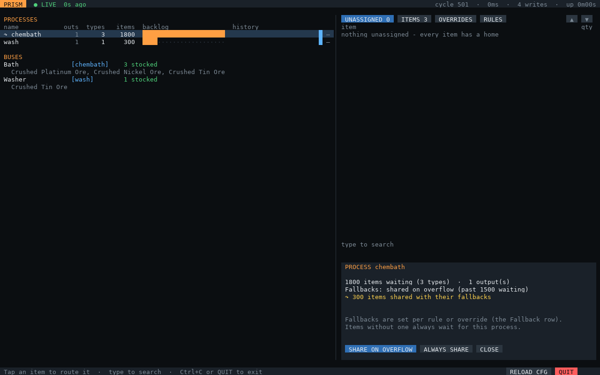
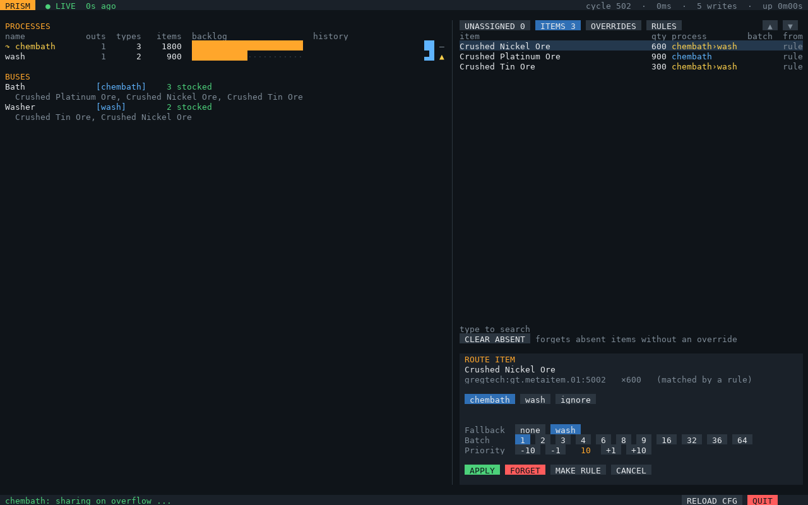

# PRISM

**Programmable Routing & Item Sorting for ME.** Dynamic item routing for **Applied Energistics 2**
using **OpenComputers**, built for **GregTech: New Horizons** ore processing but useful for any
"send these items to that machine" job.

Instead of hand-managing ore dictionary cards, a computer scans an AE2 subnet, decides where each
item should go from pattern rules and per-item overrides, and configures export buses, stocking buses and
interfaces to match. When a machine falls behind, items can be shared with a fallback process.
A second computer runs a touchscreen control panel.


## Features

- **Rule-based routing**: Lua patterns on item names (`^Crushed .+ Ore$` → `wash`), per-item overrides, priorities.
- **Export buses** that always hold the 9 highest-priority items waiting for their machine.
- **GT Stocking Input Buses** on multiblocks, configured directly: no bus speed limit, and batch items just work.
- **ME interfaces** that another network pulls from, to send finished items to your main net.
- **Fallbacks**: past a backlog limit, items are shared with a second process (chemical bath short on acid →
  ore washer), per item. Or set a process to always share from the screen.
- **Batch feeders** that send exact multiples (2, 9, 36…) for recipes that would otherwise clog on leftovers.
- **Item catalog**: every item ever seen, so you can set up routing before you have any in stock.
- **Machine monitoring**: GT machines' working/idle state, progress, power and maintenance.
- **Stall detection and alerts**: stalled processes, idle machines with work waiting, blocked feeders.
- **Touchscreen control panel**: backlog charts, assign items, edit rules with a live preview of what they'd catch.
- **One-command install and updates** from GitHub on each computer.

| Routing an item | Editing a rule |
|---|---|
|  |  |
| **A process sharing with its fallback** | **Items and their fallbacks** |
|  |  |

## Requirements

- OpenComputers and Applied Energistics 2, as shipped in GTNH. Computers on the Lua 5.3 architecture (switch a CPU's architecture by shift-right-clicking it in hand).
- A **router computer** with a wireless card, adapters, and a Database Upgrade.
- A **control computer** with a tier 3 GPU and screen, keyboard, and wireless card. Optional, but it's most of the fun.
- An **Internet Card** on each computer for `prism-update`. Optional: you can copy files manually instead.

Full hardware list and build steps: **[docs/setup.md](docs/setup.md)**.

## Install

On each computer, with an Internet Card:

```
wget -f https://raw.githubusercontent.com/aharabedian/prism/main/src/prism-update.lua /home/prism-update.lua
/home/prism-update
```

This installs the latest release of `prism`, `prism-control`, `prism-setup`, `prism-discover` and `prism-update`
onto the shell path. Run `prism-update` again any time to update to the newest release; your config and data are
never overwritten. `prism-update main` follows the development branch instead, and `prism-update OWNER/REPO`
installs from a fork ([details](docs/setup.md#updating)).

## Quick start

1. Run `prism-setup` on the router computer and choose **router**. It walks through your processes, ME network,
   export buses, feeders, machines, wireless and start on boot, and saves `/home/prism.cfg`.
2. Run `prism-setup` on the control computer and choose **control screen** (wireless and start on boot).
3. Run `prism` on the router and `prism-control` on the screen (or reboot both, if you chose start on boot).
4. Tap anything under **UNASSIGNED** to route it, or write rules in the **RULES** tab.

Added a bus or a machine later? Run `prism-setup` on the router again: with a screen attached (tier 2 or
better) it opens an [editor](docs/setup.md#changing-hardware-later) where you tap what each component is for.

## Documentation

| Doc | What's in it |
|---|---|
| [docs/setup.md](docs/setup.md) | Hardware, in-game build, first run |
| [docs/configuration.md](docs/configuration.md) | Every `prism.cfg` option, rules and patterns, fallbacks and overflow, data files |
| [docs/architecture.md](docs/architecture.md) | How routing, feeders and stall detection work; in-game verification status |
| [docs/protocol.md](docs/protocol.md) | Wireless messages between the router and the control screen |
| [docs/troubleshooting.md](docs/troubleshooting.md) | Common problems and fixes |
| [tests/README.md](tests/README.md) | The mocked test suite |
| [CONTRIBUTING.md](CONTRIBUTING.md) | Development workflow and conventions |

## Development

Everything is tested against a mocked OpenComputers/AE2/GregTech world, so no Minecraft is needed:

```
lua5.3 tests/run.lua      # all tests
luacheck .                # lint
make screens              # render the control screen from tests into PNGs (needs Python + Pillow)
```

See [CONTRIBUTING.md](CONTRIBUTING.md).

## License

[MIT](LICENSE)
