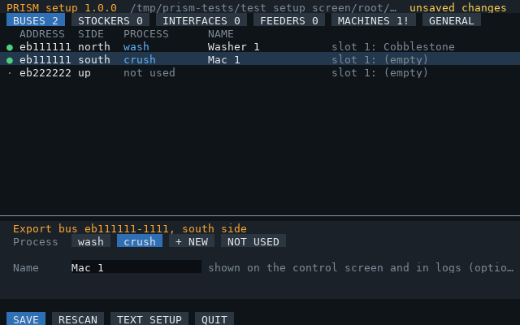

# Setup

Two computers talk over wireless. The **router** does all the work; the **control** computer is a
touchscreen front end. Only the router is required.

## The router computer

| Part | Why |
|---|---|
| Computer case or server, T2+ CPU, 2× T3.5 RAM, HDD with OpenOS | runs `prism` |
| Wireless Network Card | status and commands for the control screen |
| Internet Card (optional) | `prism-update` |
| Adapter touching the subnet's **ME Controller** (or an ME Interface on it) | reads the network |
| **Database Upgrade** (any tier) inside an adapter | stages items for export bus filters, interfaces and feeders (not needed for stocking buses) |
| Adapter touching each **cable block** that has export buses on it | one adapter covers every bus on that block |
| Adapter touching each **Stocking Input Bus (ME)** | one per stocking bus |
| Adapter touching each **ME Interface block** used as an output or by a feeder | one per interface |
| Adapter touching each **GT machine** you want to monitor (optional) | machine status, stall detection |
| Power Converter | OpenComputers doesn't run on EU directly |

Mind the component limit: a T3 CPU allows 16 components, and every adapter-adjacent block, card,
screen and the database counts. A server in a rack with component buses goes much higher.

## Export buses

For each machine (or group of identical machines):

1. Put an **Export Bus** on the subnet facing the machine's input.
2. Put **2 Capacity Cards** in it, for 9 filter slots (`slotsPerBus = 9`). Use 1 slot with no cards, or 5 with one.
3. Optionally add **Acceleration Cards** for throughput.

Export buses only get items with a batch size of 1. Use a feeder for anything else.

## Stocking input buses (multiblocks)

For a GT multiblock, a **Stocking Input Bus (ME)** (or the Advanced one) is the better choice: the
multiblock pulls straight from the subnet, so there's no export bus or feeder speed limit, and batch
items work because each recipe takes exactly what it needs.

1. Put a Stocking Input Bus (ME) on the multiblock and connect it to the subnet.
2. Put an **adapter** against it (one adapter per stocking bus).
3. Use one stocking bus per multiblock for PRISM. It fills all 16 slots.

This needs a GTNH build whose OpenComputers includes the stocking bus driver (GTNewHorizons/OpenComputers
#222). If `prism-discover` lists no stocking buses, your pack is older.

## Interfaces (another network pulls the items)

To send a process's items to another ME network (say, finished dusts to your main net), let the other
network pull them instead of pushing with an export bus:

```
subnet ─ [ME Interface BLOCK] ◄ [Import Bus] ─ main net
              │
          [Adapter]
```

1. Put an **ME Interface block** on the subnet, with an **adapter** touching it.
2. On the main net, put an **Import Bus** facing the interface. Add **Acceleration Cards** for speed.
3. The bus is the only link: no main-net cable may touch the interface block, or the two networks merge.

PRISM points the interface's 9 slots at the process's top 9 items, a stack each; the interface keeps
restocking from the subnet as the import bus empties it. Like export buses, only items with a batch size of 1.
Don't use the same interface block for a feeder.

## Feeders (batch items)

For recipes that need exact amounts (2 Cinnabar, 9 of something, etc.):

```
[Adapter] - [ME Interface BLOCK on the subnet] - [Transposer] - [Machine]
```

The interface must be the full block, not the cable part, and it needs an adapter touching it.
The transposer must touch both the interface and the machine; it's a component on its own (connect it with cable).

## Machine monitoring

Put an adapter against each GT machine (or multiblock controller). `prism-setup` lists them with their
coordinates and state; toggle one with a soft mallet to tell which is which (it shows `disabled`).

## The control computer

| Part | Why |
|---|---|
| T3 GPU and T3 screen(s) (a multiblock wall works) | 160×50 display; touch is built into T3 screens |
| Keyboard | search and rule editing |
| Wireless Network Card | talks to the router (keep it within wireless range) |
| Internet Card (optional) | `prism-update` |

## Install

On each computer with an Internet Card:

```
wget -f https://raw.githubusercontent.com/aharabedian/prism/main/src/prism-update.lua /home/prism-update.lua
/home/prism-update
```

This installs the latest release. It puts `prism`, `prism-control`, `prism-setup`, `prism-discover` and `prism-update` in `/home/bin` (on the shell path),
the modules they share in `/home/lib/prism/`, and the annotated `prism.example.cfg` in `/home` for reference.
[manifest.lua](../manifest.lua) lists every file and where it goes.

Without an Internet Card, copy the files from `src/` into `/home/bin/` and `lib/prism/` into `/home/lib/prism/` by any means
you like (pastebin, a floppy, etc.). A program started without its modules says so.

## First run

Run `prism-setup` on each computer. It first asks whether the computer is the **router** or the
**control screen** (guessing from what's attached), then walks through that role's settings.
Defaults are in `[brackets]`: Enter keeps one, `-` removes it, Ctrl+D cancels without saving.
Run it again any time to change something.

### Router

Before you start, put a different marker item in slot 1 of each export bus's filter, and of each
stocking bus's and interface's configuration, by hand (cobblestone in the washer bus, dirt in the centrifuge bus...) so
you can tell the buses apart.

| Step | You answer |
|---|---|
| Processes | which of crush, wash, thermal, centrifuge, sift (or your own names) you have machines for; it writes the matching [starting rules](configuration.md#rules), asking first if you already have rules |
| ME network, database | which one, only if there are several. Without a database, export buses, feeders and interfaces are skipped |
| Export buses | Capacity Cards per bus, then for each bus (shown with its marker item) a process (number or new name) and optional name, or Enter to skip |
| Stocking input buses | for each one (shown with the item in slot 1): process and name, or Enter to skip |
| Feeders | for each transposer (interface and machine sides found automatically): process and name, or Enter to skip |
| Interfaces | for each ME interface block not used by the network or a feeder (shown with the item in its slot 1): process and name, or Enter to skip |
| GT machines | for each machine (shown with state and coordinates): process and name, or Enter to skip |
| Wireless | port (default 4242, 0 = off) and an optional shared secret |
| Start on boot | `y` to start `prism` when the computer boots |
| Review | warnings for processes with no bus/stocker/interface/feeder or no rule; `y` saves `/home/prism.cfg` |

It ends by printing the port and secret to enter on the control screen. Settings it doesn't ask about
(`interval`, `overrides`...) are kept, and the previous file is saved as `prism.cfg.bak`.
Prefer editing by hand? See [configuration.md](configuration.md); `prism-discover` prints config lines for
every component.

### Changing hardware later

Once `/home/prism.cfg` exists, `prism-setup` on a router with a GPU and screen of tier 2 or better (80×25)
opens a full-screen editor instead of the questions. Stop `prism` first (Ctrl+C), since both use the screen.



| Tab | Shows | Tap |
|---|---|---|
| BUSES, STOCKERS, INTERFACES, FEEDERS, MACHINES | every component found (with its slot 1 marker, or a machine's state and coordinates), plus configured ones that weren't found, marked `!` in red | a row, then a process (or **+ NEW** and type a name), **NOT USED**, or the name field. Feeders: tap the interface or a side to cycle it. Missing ones: **DROP** |
| GENERAL | ME network, database, Capacity Cards, wireless port and secret, start on boot; current warnings below | the setting |

Keys: type into the field you tapped (Enter keeps it, Esc cancels); otherwise Up/Down pick a row and
Left/Right switch tabs. **RESCAN** looks for components again and keeps your edits. **SAVE** lists every change
and warning, then writes `prism.cfg` (keeping `prism.cfg.bak`). **QUIT** with unsaved changes asks again.
Rules and processes aren't edited here: use the control screen's RULES tab, or **TEXT SETUP** /
`prism-setup --text` for the guided setup above.

### Control screen

| Step | You answer |
|---|---|
| Wireless | the same port and secret as the router |
| Alerts | beep on new alerts or not |
| Start on boot | `y` to start `prism-control` when the computer boots |

It saves `/home/prism-control.cfg`, and warns if there's no tier 3 GPU and screen.

Then run `prism` on the router (it logs each filter change and any item with no rule) and `prism-control`
on the screen (it shows **LIVE** in the header once it hears the router).

## Start on boot

`prism-setup`'s start-on-boot step adds the program's name as a line in `/home/.shrc`, which the OpenOS shell
runs when the computer boots, and removes the other PRISM program's line if the computer changed role.
Other lines in `.shrc` are kept. Ctrl+C in the program gets you to the shell.

## Updating

Run `prism-update` on each computer, then restart `prism` / `prism-control`. By default it installs the newest
release of `aharabedian/prism`. To follow something else:

| Command | Installs | Later `prism-update`s |
|---|---|---|
| `prism-update` | the saved choice; the first time, the latest release | same choice |
| `prism-update latest` | the latest release | newer releases |
| `prism-update main` | the `main` branch: newest changes, may be unfinished | `main` again |
| `prism-update v0.5.0` | that release | stays on it |
| `prism-update OWNER/REPO [REF]` | a fork: its latest release, or a branch/tag | same fork and choice |

The choice is saved in `/home/.prism-update.cfg`. A repo with no releases yet installs from `main`.
`prism-update --help` lists the options.

Coming from a setup that predates the PRISM name (`/home/router.cfg`)? The first `prism-update`
renames `router.cfg` and `router-*.cfg` to `prism.cfg` / `prism-*.cfg`, keeping your settings and data.


Your config files are kept on every update;
run `prism-setup` and SAVE in the editor (or press Enter through `prism-setup --text`) to rewrite the config with any new options. If the router and screen run different
versions, the screen's header shows a yellow `router X ≠ screen Y` badge.
